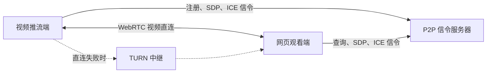
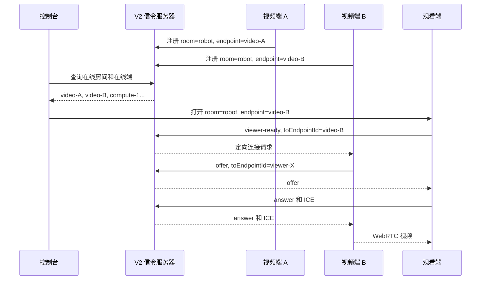

# P2P V1 与 P2P V2 推流逻辑对照

## 1. 文档目的

本文说明控制台中 `P2P推流 (BETA)`（下文称 V1）和 `P2P推流 V2` 的工作流程、协议差异、兼容关系及当前落地范围。

V2 的核心变化不是更换 WebRTC 编解码或媒体传输方式，而是把信令模型从“按房间寻找唯一推流端”升级为“先发现房间内的在线端，再选择具体端建立连接”。

## 2. 两个版本共同的部分

V1 和 V2 都采用以下基础结构：

1. 摄像头或屏幕由推流端本地采集。
2. 推流端与观看端通过 HTTPS 信令服务交换 WebRTC SDP 和 ICE Candidate。
3. 视频本身不经过普通 HTTP 信令接口转发。
4. 网络允许时，视频通过 WebRTC 在推流端和观看端之间直连。
5. 无法直连时，由配置中的 TURN 服务器中继媒体。
6. 每个观看端都与推流端建立独立的 `RTCPeerConnection`，因此一个视频端可以同时服务多个观看端。
7. 两个版本当前使用相同的摄像头采集、输出分辨率、帧率、码率、预览和 ICE/TURN 配置。



信令服务器负责让两端相互发现和交换连接信息。只有使用 TURN 时，视频媒体才会经过服务器中继。

## 3. V1：以房间为唯一视频源

### 3.1 推流端启动

1. 推流端生成一个临时 `peerId`。
2. 推流端进入指定 `room`，通过 `/api/rooms/{room}/message` 发送 `pusher-online`。
3. 信令服务器把该 `peerId` 记为房间的 `activePusher`。
4. 推流端每 5 秒发送一次 `pusher-heartbeat`。
5. 服务器在 15 秒内收不到推流端心跳时，将该推流端判定为过期。

V1 的一个房间同一时间只允许一个活跃推流端。第二个推流端使用相同房间号发送消息时，服务器返回 `409 room already has an active pusher`。

### 3.2 观看端连接

V1 观看链接只包含房间号：

```text
https://p2p.cityulive.com/watch.html?room=robot
```

连接流程如下：

1. 观看端进入 `robot` 房间并发送 `viewer-ready`。
2. 服务器按角色把请求交给该房间唯一的 `pusher`。
3. 推流端为该观看端创建单独的 WebRTC 连接并发送 `offer`。
4. 观看端返回 `answer`，双方继续交换 ICE Candidate。
5. ICE 协商成功后开始传输视频。

V1 不需要选择具体视频端，因为“房间号”本身就等价于该房间唯一的视频源。

### 3.3 V1 的限制

- 同一房间不能同时存在多个视频推流端。
- 服务端只区分 `pusher`、`viewer` 和普通 `peer`，不能规范表示计算服务器、机械臂端和前端。
- 前端无法列出同一房间内的多个发送请求端。
- 多个设备要同时推流时，必须分配不同房间号。

## 4. V2：房间内注册多个逻辑端

### 4.1 新增的端模型

V2 在 `room` 下增加 `endpointId`。这里的端不是 TCP/UDP 公网端口，而是客户端在信令系统中的逻辑身份。

当前支持的角色如下：

| role | 含义 | 当前控制台能否点击观看 |
| --- | --- | --- |
| `video-pusher` | 视频推流端 | 可以 |
| `compute` | 计算服务器 | 不可以，仅显示 |
| `robot-edge` | 机械臂端侧 | 不可以，仅显示 |
| `frontend` | 前端控制端 | 不可以，仅显示 |
| `viewer` | 视频观看端 | 不在控制台端列表中展示 |

同一个房间可以注册多个不同的 `endpointId`，也可以同时存在多个 `video-pusher`。`endpointId` 在同一房间内必须唯一；同一个 ID 被另一个 `peerId` 占用时，注册接口返回冲突。

### 4.2 V2 推流端启动

控制台网页端当前执行以下流程：

1. 采集摄像头并建立本地预览。
2. 生成 `peerId` 和 `endpointId`。
3. 调用 `/api/v2/rooms/{room}/endpoints` 注册为 `video-pusher`。
4. 上报显示名称、视频能力、视频参数和 `waiting` 状态。
5. 每 5 秒发送端心跳；有观看连接时状态更新为 `connected`，否则为 `waiting`。
6. 轮询只属于当前 `endpointId` 或 `peerId` 的 V2 信令消息。
7. 收到定向观看请求后，为该观看者建立独立 WebRTC 连接。

V2 端超过 15 秒没有心跳会被自动移出在线端目录。正常停止时，客户端会主动发送 `offline` 注销，通常无需等待自动过期。

### 4.3 V2 房间和端发现

控制台点击“网页端观看”后执行两级发现：

1. 调用 `GET /api/v2/rooms` 获取所有在线 V2 房间。
2. 用户从下拉菜单选择房间。
3. 调用 `GET /api/v2/rooms/{room}/endpoints` 获取该房间的在线端。
4. 列表显示端名称、`endpointId`、角色和状态。
5. 只有 `video-pusher` 可以点击；其他角色只用于展示在线状态。

房间目录会排除只有 `viewer` 的房间。只要房间内存在 `video-pusher`、`compute`、`robot-edge` 或 `frontend`，该房间就可以出现在 V2 房间下拉菜单中。因此有些在线房间可能显示 `0` 个视频端，此时只能查看端状态，不能观看。

### 4.4 V2 定向观看

点击某个视频端后，控制台生成包含房间和目标端 ID 的链接：

```text
https://p2p.cityulive.com/watch.html?room=robot&v=2&endpoint=console-video-xxxxxxxxxxxx
```

连接流程如下：

1. 观看页识别 `v=2` 和目标 `endpoint`。
2. 观看端在同一房间注册自己的 `viewer` 端。
3. 观看端向选中的 `toEndpointId` 发送 `viewer-ready`。
4. 服务器仅把定向信令交给匹配的目标端。
5. 目标视频端创建 `offer`，观看端返回 `answer`。
6. 后续 ICE Candidate 继续携带目标端和连接 ID，避免与同房间其他端串线。
7. WebRTC 建连后，视频仍采用直连或 TURN 中继，V2 不会额外增加媒体转发层。



## 5. 核心区别汇总

| 对比项 | P2P V1 | P2P V2 |
| --- | --- | --- |
| 定位方式 | `room` | `room + endpointId` |
| 同房间视频端数量 | 只允许 1 个活跃推流端 | 允许多个 `video-pusher` |
| 观看方式 | 输入或选择房间 | 先选在线房间，再选具体视频端 |
| 端角色 | `pusher` / `viewer` | 视频、计算、机械臂、前端、观看端 |
| 在线目录 | 只列出有活跃推流端的房间 | 列出房间及其全部非观看端 |
| 信令路由 | 按角色或 `peerId` | 优先按 `endpointId`，也保留 `peerId` |
| 心跳对象 | 房间唯一推流端 | 每一个注册端独立心跳 |
| 自动过期 | 推流端默认 15 秒 | 每个 V2 端默认 15 秒 |
| 多观看者 | 支持 | 支持 |
| 多发送端发现 | 不支持 | 支持 |
| 视频传输方式 | WebRTC 直连或 TURN | WebRTC 直连或 TURN，无变化 |
| 观看链接 | `?room=...` | `?room=...&v=2&endpoint=...` |

## 6. 接口对照

### 6.1 V1 接口

```text
GET  /api/rooms
GET  /api/rooms/{room}/status
POST /api/rooms/{room}/message
GET  /api/rooms/{room}/messages
POST /api/rooms/{room}/reset
```

### 6.2 V2 接口

```text
GET  /api/v2/rooms
GET  /api/v2/rooms/{room}/endpoints
POST /api/v2/rooms/{room}/endpoints
POST /api/v2/rooms/{room}/endpoints/{endpointId}
POST /api/v2/rooms/{room}/message
GET  /api/v2/rooms/{room}/messages
```

端注册请求示例：

```json
{
  "endpointId": "camera-front-01",
  "peerId": "peer-7f3a",
  "role": "video-pusher",
  "displayName": "前置摄像头",
  "status": "waiting",
  "capabilities": {
    "watchable": true,
    "media": "video",
    "protocol": "webrtc"
  },
  "metadata": {
    "source": "cloud-service-console"
  }
}
```

端心跳请求示例：

```json
{
  "action": "heartbeat",
  "peerId": "peer-7f3a",
  "status": "connected"
}
```

定向信令请求至少包含：

```json
{
  "fromEndpointId": "viewer-a1b2",
  "fromPeerId": "peer-a1b2",
  "toEndpointId": "camera-front-01",
  "toPeerId": "",
  "connectionId": "connection-c3d4",
  "kind": "viewer-ready",
  "payload": {
    "at": 1787620000000
  }
}
```

## 7. V1 与 V2 的兼容和隔离边界

### 7.1 已隔离的内容

- V1 使用 `/api/rooms/...`，V2 使用 `/api/v2/rooms/...`。
- 服务端分别保存 V1 `messages` 和 V2 `v2_messages`。
- V1 的活跃推流端不会自动出现在 V2 端目录。
- V2 端不会接收 V1 信令。
- 即使 V1 和 V2 使用相同房间名，正常推流、查询和观看也不会互相配对或串流。
- 原有 V1 客户端不需要修改，可以继续使用原接口和原观看链接。

### 7.2 仍然共用的内容

- 同一个 P2P 信令服务进程和域名。
- 同一套 HTTPS、STUN/TURN 和服务器网络资源。
- 同一个进程内的房间容器。
- 服务重启、服务器故障、TURN 故障或带宽耗尽会同时影响两个版本。

### 7.3 当前需要注意的 reset 边界

当前旧接口 `POST /api/rooms/{room}/reset` 会删除整个内存房间对象。V1 和 V2 使用相同房间名时，如果外部程序在 V2 运行期间调用该旧接口，且当时没有活跃 V1 推流端，V2 的端注册和待处理信令也会一起被清除。

普通的 V1/V2 开始推流、停止推流和观看不会触发跨协议配对；但从严格意义上说，在 `reset` 接口改成只清理 V1 状态之前，两套协议不是物理上的完全零影响。客户端会在下一次 V2 心跳收到 `404` 后重新注册，因此通常可以自动恢复，但连接过程可能短暂中断。

## 8. 当前实现和部署范围

截至 2026-08-25：

- 香港网页控制台已经提供 `P2P推流 (BETA)` 和 `P2P推流 V2` 两个入口。
- 香港 `https://p2p.cityulive.com` 已部署 V2 房间目录、端目录和定向信令接口。
- 控制台浏览器模式已经支持 V2 视频端注册、心跳、定向推流和定向观看。
- V2 控制台可以看到已注册的 Compute 和机械臂端，但只有视频端可点击观看。
- Compute 和机械臂工程目前尚未实际接入 V2 注册/心跳；接入后才会真实出现在列表中。
- 本地 P2P 推流脚本目前仍使用 V1；控制台桌面模式启动 V2 时会提示尚未提供本地脚本接入。
- 桌面 EXE 尚未针对本次 V2 功能重新构建。
- 广州 P2P 服务尚未同步本次 V2 接口，因此广州域名暂时不能使用完整 V2 端目录功能。

## 9. 后续接入规范

新的视频端、计算服务器、机械臂端或前端接入 V2 时，应统一执行：

1. 使用稳定、可读且在房间内唯一的 `endpointId`。
2. 启动后先注册端，再发送任何 V2 信令。
3. 每 5 秒发送一次心跳，不能只依赖停止时注销。
4. 正常退出时发送 `action=offline`。
5. 每条连接信令携带 `fromEndpointId`、`fromPeerId`、`toEndpointId` 和 `connectionId`。
6. 收到目标端离线或接口返回 `endpoint_unavailable` 时，停止当前协商并重新读取端目录。
7. 视频观看只允许选择声明为 `video-pusher` 且具备视频能力的端。

建议下一步先将旧 `reset` 改为仅清理 V1 字段，然后再让本地脚本、Compute 和机械臂端按同一注册规范接入 V2。
